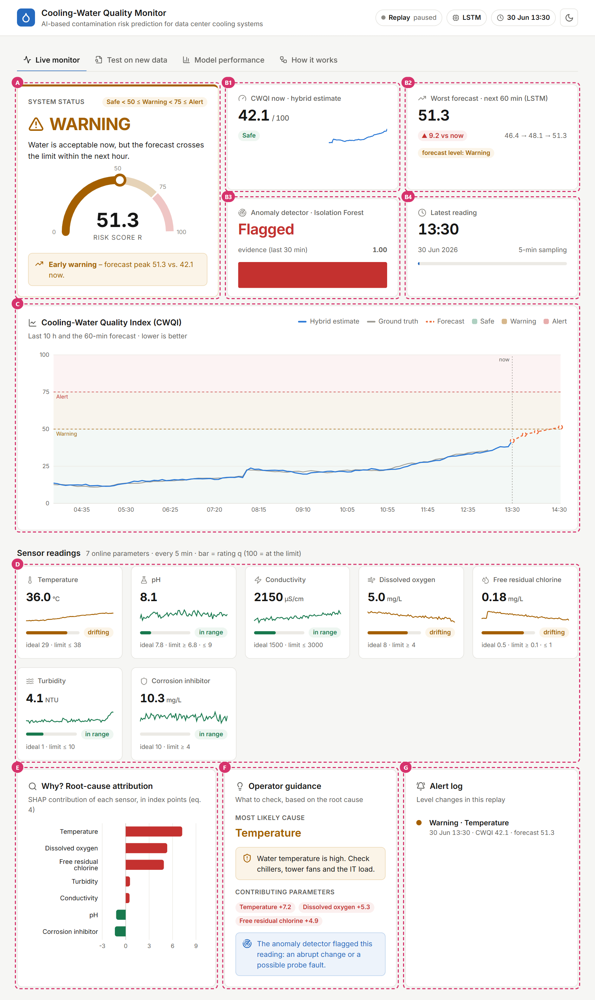
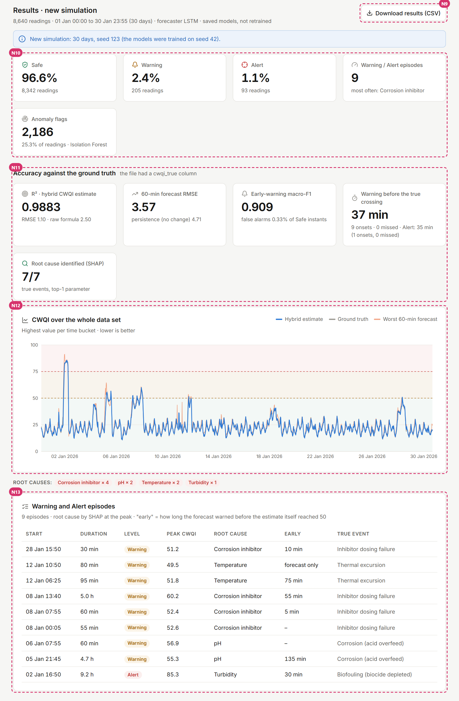
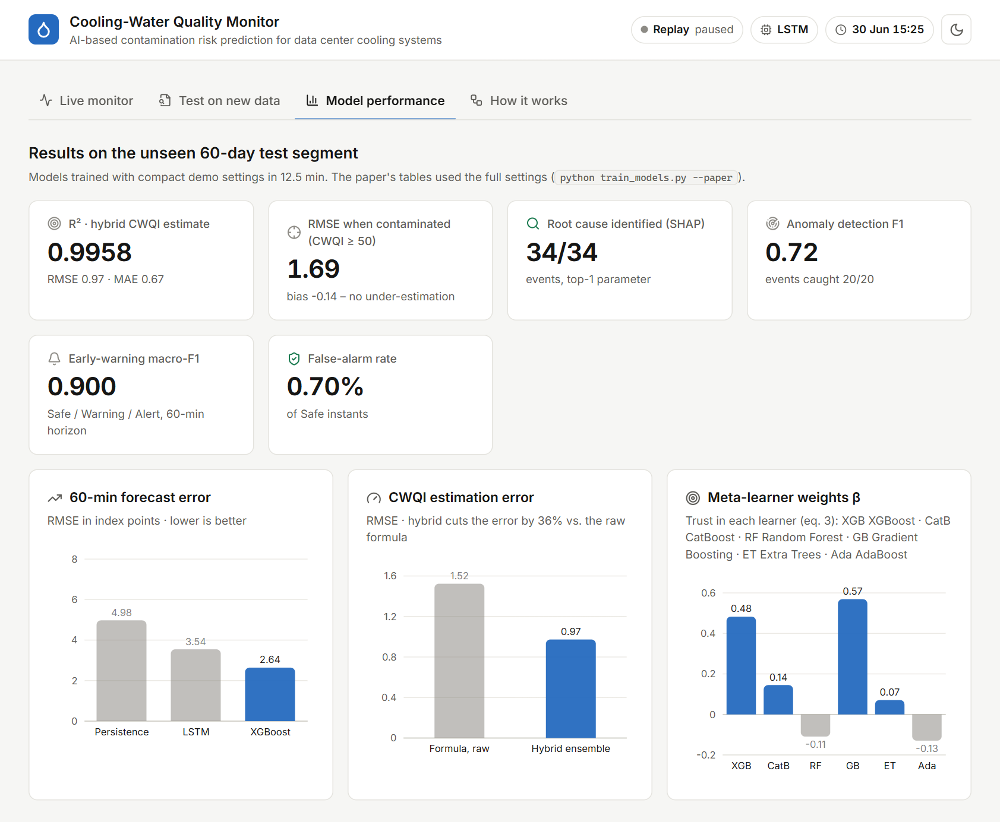

# Contamination Detection: AI-Based Water Quality Monitoring for Data Center Cooling Systems

Cooling water in an AI data center is usually checked by a lab about once a day, so contamination that starts in the morning is found the next day. This project reads **seven water sensors every 5 minutes**, forecasts the water quality **up to 60 minutes ahead**, and raises **Safe / Warning / Alert** before the limit is crossed. It also names the sensor responsible and tells the operator what to check.

**Minor Project, B.Tech CSE (7th semester, 2026-27)**
Tanvi Nishad, Ayush Abhinav, Tanvi Nagar · Guide: Mr. Anand Bhushan Pandey
JIMS Engineering Management Technical Campus, Greater Noida (GGSIPU)



> **Note on data.** No public data set of data center cooling-water chemistry exists, so all data comes from a physics-informed simulator of an open recirculating cooling tower (Section [Data](#data)). The system has not yet been validated on a real plant.

---

## Features

- **Cooling-Water Quality Index (CWQI)** from temperature, pH, conductivity, dissolved oxygen, free residual chlorine, turbidity and corrosion inhibitor. 0 = ideal, lower is better. Safe < 50 ≤ Warning < 75 ≤ Alert.
- **Hybrid stacked ensemble**: six tree models (XGBoost, CatBoost, Random Forest, Gradient Boosting, Extra Trees, AdaBoost) and a linear meta-learner learn only the *correction* to the physics-based index, so severe contamination is not under-estimated.
- **Root cause with SHAP**: the contribution of each sensor, plus operator guidance ("check the biocide dosing").
- **Forecast** 15, 30 and 60 minutes ahead with an **LSTM** or an **XGBoost** lag-feature model.
- **Anomaly detection** (Isolation Forest) for spikes, stuck probes and sudden changes.
- **Early warning** by risk fusion: `R = max(CWQI now, worst forecast in the next hour)`.
- **Complete system**: MQTT sensor gateway → ingestion service → SQLite/MySQL (+ InfluxDB) → models → alerts (dashboard pop-up and sound, log, desktop, e-mail, phone push, webhook), a **REST API** (FastAPI) and a **React dashboard**. Docker Compose for deployment.
- **Test on new data**: upload a CSV file of sensor readings, or generate a new simulated data set, and run the saved models on all of it at once.

---

## Quick start (Windows)

Needs **Python 3.12** (3.10+ should work). Node.js is *not* needed: the built dashboard is included in `frontend/dist`.

```bash
git clone https://github.com/Tanvi958/Contamination-Detection.git
cd Contamination-Detection
pip install -r requirements.txt
```

Then double-click **`Start Dashboard.bat`**, or run:

```bash
python -m uvicorn api:app --port 8765
```

Wait about one minute while the models load, then open **http://127.0.0.1:8765**. The API documentation is at http://127.0.0.1:8765/docs.

This one command starts the **whole live system**: the API also starts an MQTT broker (if none is running), a **sensor feeder agent** that keeps publishing fresh readings, and the ingestion worker that stores and assesses them. The dashboard opens on **Live (MQTT)** and updates by itself every second. No CSV file is read for live data.

The trained models are already in `models/`, so no training is needed.

**Linux / macOS:** the same `pip install` and `uvicorn` commands work; the `.bat` files are Windows only. On Linux, install the CPU build of PyTorch first to avoid a large CUDA download:

```bash
pip install torch==2.14.0 --index-url https://download.pytorch.org/whl/cpu
pip install -r requirements.txt
```

**If the models fail to load** (for example with a different scikit-learn version), retrain them: `python train_models.py` (about 12 minutes).

---

## Using the dashboard

| Tab | What it does |
|---|---|
| **Live monitor** | **Live (MQTT)** (default): continuously updating readings from the sensor feeder agent, the risk level, chart and alert log. **Inject** a fault (for example biofouling, severity 1.5×, develops over 3 h) and watch the early warning, the root cause and the alert. **Built-in replay**: replays the unseen 60-day test segment; press **Start**, and **Go to 6 h before this event** jumps to a recorded contamination event. |
| **Test on new data** | Runs the saved models (no retraining) on a whole new data set. See below. |
| **Model performance** | Results on the unseen 60-day test segment. |
| **How it works** | The pipeline and architecture. |

The control panel on the left chooses the data source (built-in replay or live MQTT), the forecaster (LSTM or XGBoost), and the playback speed.

### Test on new data



Two ways to give data:

1. **Upload a CSV file.** Columns `ts, temp, ph, cond, do, frc, turb, inhib` (full names such as *Temperature* or *Conductivity* also work). Readings should be 5 minutes apart; other intervals are converted. At least 36 rows. Optional columns `cwqi_true` and `event_type` let the page score the accuracy. Press **Sample CSV** to download an example.

   ```csv
   ts,temp,ph,cond,do,frc,turb,inhib
   2026-01-01 00:00:00,28.9,7.98,1876,7.02,0.86,1.43,10.7
   2026-01-01 00:05:00,29.0,7.99,1881,7.05,0.85,1.40,10.6
   ```

2. **Generate new simulated data** with another random seed than training (42): new events, noise and sensor faults. Optionally with 2× sensor noise or a pH probe that reads 0.3 too high.

The result shows the share of time in Safe / Warning / Alert, every Warning/Alert episode with its SHAP root cause, the accuracy (when the true index is known), and a **Download results (CSV)** button with the assessment of every reading.

The same is available from the command line: `python evaluate_new_data.py` (3 new seeds plus noise and drift tests, about 3 minutes).

---

## The complete live system

**One command** (`Start Dashboard.bat` or `python -m uvicorn api:app --port 8765`) runs everything:

```
sensor feeder agent --MQTT--> broker (port 1883) --MQTT--> ingestion worker --> database --> all models --> alerts
                                                                                    \--> React live monitor (polls every second)
```

* **Sensor feeder agent** (`wq_system/feeder.py`): generates physics-consistent readings on the fly with the simulator's process equations (`wq_model/live_stream.py`), never from a file. Each reading is 5 minutes of plant time; the plant clock starts at the current time and the agent first sends the last 4 h so the models have a full window at once. Every 1 s by default; choose **Real** in the control panel (or `FEEDER_INTERVAL=300`) for true real time, one reading every 5 minutes. The simulated plant starts a natural contamination event now and then (switch off with **Random contamination events**), and **Inject** / **Clear fault** / **Pause** send MQTT commands to the agent.
* **Ingestion worker** (`wq_system/ingest.py`): the same code as `ingest_service.py`, running in the API with its already loaded models.
* Everything on the live monitor is read back from the database (`data/monitor.db`). Alerts are written to `data/alerts.log`.

**Separate processes** (as on a real plant, where the feeder is replaced by the sensor gateway): double-click **`Start Live System.bat`**. It sets `LIVE_AGENT=0` for the API and opens four windows:

| Window | Command | Role |
|---|---|---|
| MQTT broker | `python broker.py` | receives sensor messages on port 1883 |
| Ingestion service | `python ingest_service.py` | MQTT → database → all models → alerts |
| Sensor feeder agent | `python sensor_publisher.py --interval 1` | publishes one fresh simulated reading (5 plant minutes) per second |
| API + dashboard | `python -m uvicorn api:app --port 8765` (with `LIVE_AGENT=0`) | http://127.0.0.1:8765 |

Do not run `ingest_service.py` next to an API with `LIVE_AGENT=1`: every reading would be stored twice.

A real sensor gateway sends this JSON to the MQTT topic `datacenter/cooling/<device>/readings`, or to `POST /readings`:

```json
{"ts": "2026-06-30T00:05:00", "temp": 30.1, "ph": 7.9, "cond": 1900, "do": 7.2, "frc": 0.45, "turb": 1.3, "inhib": 9.5}
```

**Docker** (MySQL, InfluxDB and Mosquitto included):

```bash
docker compose up --build
```

Dashboard at http://127.0.0.1:8765. The Docker build compiles the React app itself. Compose runs the feeder and ingestion as their own containers and sets `LIVE_AGENT=0` for the API. The passwords in `docker-compose.yml` are local demo defaults; change them before using it anywhere else.

### Notifications

Every level change (and a return to Safe after 30 minutes) and every new burst of anomalies goes to the dashboard (pop-up and beep), `data/alerts.log`, and a desktop notification. E-mail, phone push (free **ntfy** app) and a webhook are optional: copy `settings.env.example` to `settings.env` and fill in the lines you need. `settings.env` is git-ignored; never commit it.

---

## REST API

Interactive documentation: http://127.0.0.1:8765/docs

| Endpoint | What it does |
|---|---|
| `POST /predict` | send up to 48 recent readings; get CWQI, forecast, level, anomaly score and SHAP attribution (nothing stored) |
| `POST /readings` | send one reading over HTTP instead of MQTT (stored, assessed, alerts sent) |
| `GET /latest` | latest assessment |
| `GET /readings`, `/assessments`, `/alerts` | history from the database |
| `PUT /forecaster/{lstm or xgb}` | forecaster used by `POST /readings` |
| `GET /metrics`, `/parameters` | test-set results; parameter limits and weights |
| `POST /dashboard/newdata/csv`, `/dashboard/newdata/simulate` | run the models on a whole new data set |

---

## Results

Demo models (compact settings, trained in about 12 minutes), on the unseen 60-day test segment (`models/metrics.json`):

| Metric | Value |
|---|---|
| CWQI estimate R² / RMSE | 0.9958 / 0.97 (index formula on raw readings: RMSE 1.52) |
| RMSE on contaminated samples (CWQI ≥ 50) | 1.69, bias −0.14 |
| 60-min forecast RMSE | LSTM 3.54, XGBoost 2.64, no-change baseline 4.98 |
| Root cause identified (SHAP, top-1) | 34 of 34 events |
| Anomaly detection F1 | 0.72, all 20 events caught |
| Early-warning macro-F1 / false alarms | 0.900 / 0.7 % |

On new simulated data that the models never saw (3 other seeds, 60 days each, `python evaluate_new_data.py`): R² 0.994-0.995, macro-F1 0.90-0.93, root cause 58 of 59 events, Warning on average 52-61 minutes before the true crossing.



### Limitations

- All data is simulated with one simulator configuration; no real-plant validation yet.
- The CWQI weights were set by engineering judgment, without a sensitivity analysis.
- A slowly drifting probe is not detected: with the pH probe reading 0.3 too high, the estimate's R² drops clearly.
- On new data the demo LSTM gave short Alert lead times (3-27 min; XGBoost 21-55 min), with only 3-5 Alert onsets per data set.

---

## Data

A physics-informed simulator (`wq_model/simulator.py`) of an open recirculating cooling tower: IT load with daily and weekly cycles, evaporation and a blowdown controller for conductivity, chlorine dosing every 8 hours with temperature-dependent decay, dissolved oxygen from the saturation curve. Five contamination types (biofouling, scaling, corrosion, inhibitor dosing failure, thermal excursion), sensor noise, spikes, stuck probes and 1 % missing readings.

Training data: 240 days at 5-minute steps (69,120 readings, seed 42), 81 contamination events, 50 sensor faults, split by time into 60 / 15 / 25 % (train / validation / test).

---

## Train the models yourself

```bash
python train_models.py                       # compact settings, about 12 minutes
python train_models.py --paper               # settings of the paper, about 1.5 hours, ~1 GB of models
python train_models.py --xgb-forecaster-only # only the XGBoost forecaster, about 1 minute
```

## Change the dashboard

The React source is in `frontend/` (React 18, Vite, Recharts). Needs Node.js 18+.

```bash
cd frontend
npm install
npm run dev     # http://localhost:5173, API calls go to :8765
npm run build   # writes frontend/dist, which the API serves
```

---

## Project structure

| Path | What it does |
|---|---|
| `wq_model/cwqi.py` | the seven parameters, their limits and weights; the CWQI |
| `wq_model/simulator.py` | cooling-loop simulator, fault types, sensor faults |
| `wq_model/features.py` | gap filling, 21 features, base index |
| `wq_model/estimator.py` | hybrid stacked ensemble and SHAP attribution |
| `wq_model/forecaster.py`, `xgb_forecaster.py` | LSTM and XGBoost forecasters |
| `wq_model/anomaly.py` | Isolation Forest and anomaly evidence |
| `wq_model/fusion.py`, `guidance.py` | risk score, levels, operator guidance |
| `wq_model/pipeline.py` | the whole pipeline for one new reading |
| `wq_system/` | config, database, notifications, MQTT processing, dashboard endpoints, batch test on new data |
| `api.py` | REST API; serves the dashboard |
| `broker.py`, `ingest_service.py`, `sensor_publisher.py` | live MQTT system as separate processes |
| `wq_system/live.py`, `feeder.py`, `ingest.py`, `wq_model/live_stream.py` | built-in live system: feeder agent, ingestion worker, step-by-step plant simulator |
| `train_models.py`, `evaluate_new_data.py` | training and evaluation on new data |
| `frontend/` | React dashboard (`dist/` is the built version) |
| `models/` | trained models, test results, the replayed test stream |
| `Dockerfile`, `docker-compose.yml`, `docker/` | container deployment |
| `app.py` | older Streamlit dashboard, no longer used |
